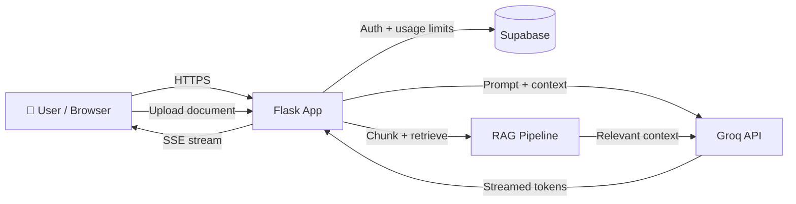

<div align="center">

<picture>
  <source media="(prefers-color-scheme: dark)" srcset="assets/logo-dark.png">
  <source media="(prefers-color-scheme: light)" srcset="assets/logo.png">
  
</picture>

<br/>

**A full-stack AI chat assistant with streaming responses, document-aware answers (RAG), secure sign-in and server-side rate limiting.**

<br/>

[](https://mehta-ai-assistance.vercel.app)
[](https://www.python.org/)
[](https://flask.palletsprojects.com/)
[](https://supabase.com/)
[](https://groq.com/)

</div>

---

## 📖 Overview

**Mehta AI** is a web-based AI assistant I built end to end: Flask backend, Supabase for authentication and data, and the Groq API for fast LLM inference. It started as a basic chatbot and has grown through several iterations into an app with real-time streaming, document upload, and usage limits enforced on the server.

> 🌐 **Live:** [mehta-ai-assistance.vercel.app](https://mehta-ai-assistance.vercel.app)

---

## ✨ Features

| | Feature | Description |
|---|---|---|
| 💬 | **AI Chat** | Conversational assistant powered by LLMs served through the Groq API |
| ⚡ | **Streaming Responses** | Answers stream token by token using Server-Sent Events (SSE) |
| 📄 | **Document Q&A (RAG)** | Upload a document and ask questions grounded in its content |
| 🔐 | **Authentication** | Sign-in / sign-up flow backed by Supabase |
| 🚦 | **Server-side Rate Limiting** | Daily usage limits enforced in Supabase so they can't be bypassed from the browser |
| 🎨 | **Modern UI** | Responsive interface with animated sign-in page |
| ☁️ | **Deployed on Vercel** | Production deployment with environment-based configuration |

---

## 🏗️ Architecture



---

## 🧰 Tech Stack

| Layer | Technology |
|---|---|
| **Backend** | Python, Flask |
| **LLM Inference** | Groq API |
| **Auth & Database** | Supabase |
| **Frontend** | HTML, CSS, JavaScript |
| **Streaming** | Server-Sent Events (SSE) |
| **Deployment** | Vercel |

---

## 🚀 Getting Started

### Prerequisites

- Python 3.10+
- A [Supabase](https://supabase.com/) project
- A [Groq](https://console.groq.com/) API key

### 1. Clone the repository

```bash
git clone https://github.com/Ra-kumar4216/Mehta-Ai-Assistance-.git
cd Mehta-Ai-Assistance-
```

### 2. Create a virtual environment and install dependencies

```bash
python -m venv venv

# macOS / Linux
source venv/bin/activate
# Windows
venv\Scripts\activate

pip install -r requirements.txt
```

### 3. Configure environment variables

Create a `.env` file in the project root:

```env
GROQ_API_KEY=your_groq_api_key
SUPABASE_URL=your_supabase_project_url
SUPABASE_KEY=your_supabase_key
SECRET_KEY=your_flask_secret_key
```

> ⚠️ Never commit your `.env` file. Make sure it is listed in `.gitignore`.

### 4. Run the app

```bash
python app.py
```

Open **http://localhost:5000** in your browser.

---

## 🔒 Security Notes

- API keys and secrets live in environment variables, never in source code.
- Rate limits are enforced **server-side** in Supabase, not in client-side storage.
- Authentication is handled by Supabase; protected routes verify the session on the server.

---

## 🛣️ Roadmap

- [ ] Conversation history sidebar
- [ ] Multi-document RAG with source citations
- [ ] Model selector in the UI
- [ ] Unit and integration tests
- [ ] Dockerfile for one-command setup

---

## 🤝 Contributing

Contributions, issues and feature requests are welcome.

1. Fork the project
2. Create your feature branch: `git checkout -b feature/amazing-feature`
3. Commit your changes: `git commit -m "Add amazing feature"`
4. Push to the branch: `git push origin feature/amazing-feature`
5. Open a Pull Request

---

## 📄 License

Distributed under the MIT License. See [`LICENSE`](LICENSE) for details.

---

## 👨‍💻 Author

**Ratan Kumar** — Software Engineer | Java Full Stack & AI/ML Developer

[](https://github.com/Ra-kumar4216)
[](https://linkedin.com/in/ratan-kumar-metha)
[](https://ratankumar-portfolio.vercel.app)

<div align="center">

⭐ If you found this project useful, consider giving it a star!

</div>
